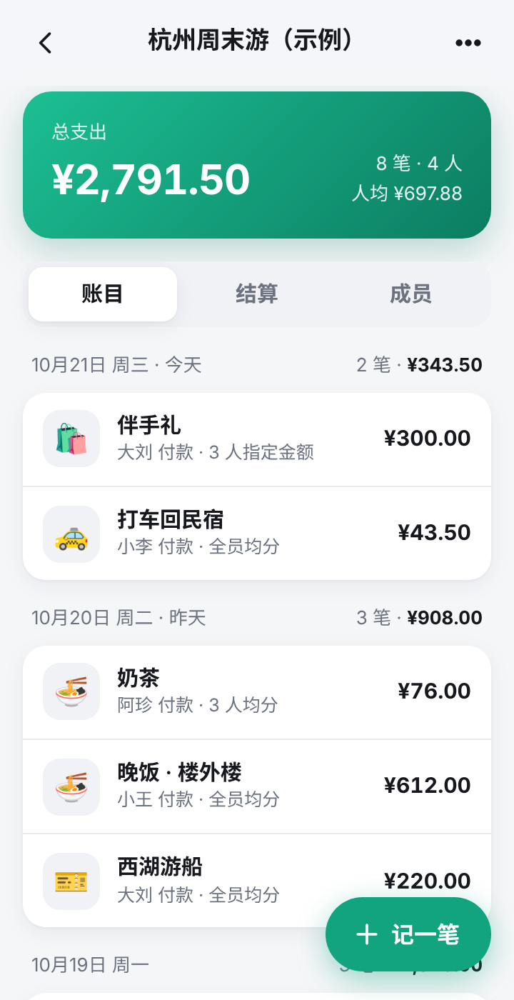
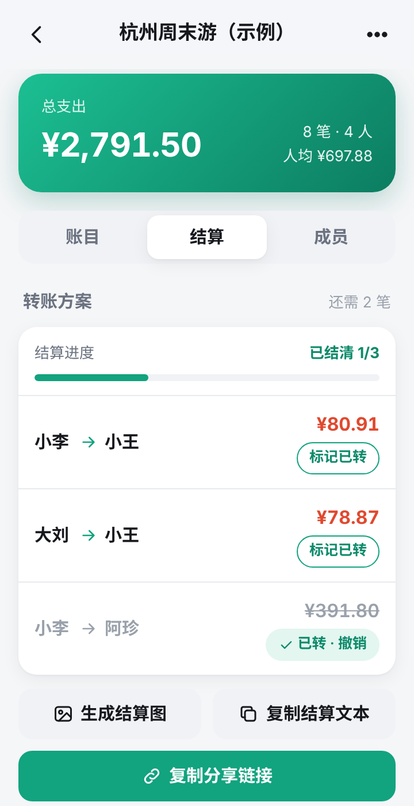
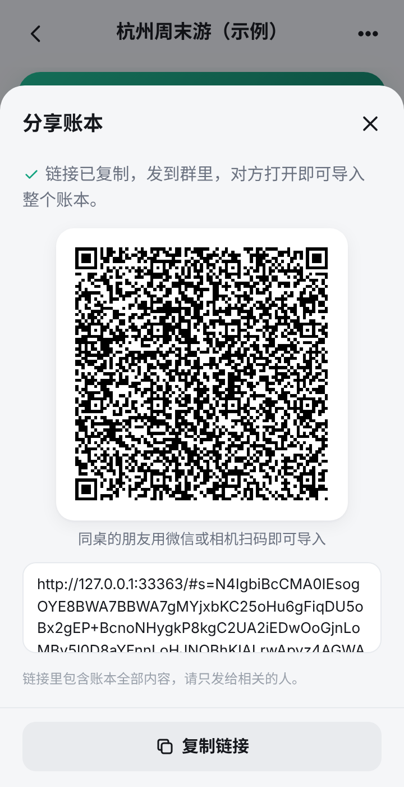
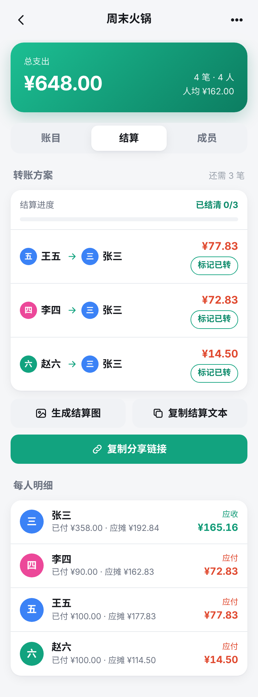
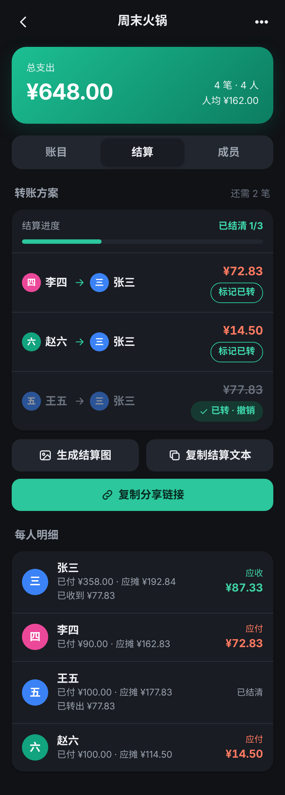
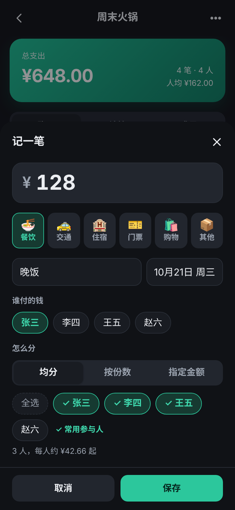
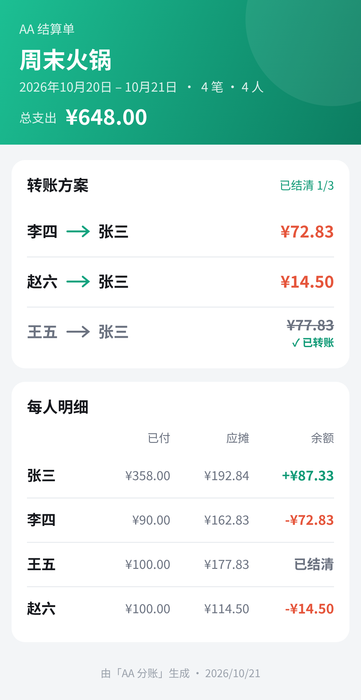

# AA 分账

<p align="center">
  
  
  
</p>

<p align="center"><b>在线使用：<a href="https://ash-ze.github.io/aa-split/">https://ash-ze.github.io/aa-split/</a></b>（打开后点「先看看示例账本」即可体验）</p>

一个纯前端的中文 AA 分账小工具，适合**聚餐、旅行、合租**等多人一起花钱的场景：记下谁付了多少、哪些人分摊，自动算出每人余额和**最少的转账方案**，一键复制分享链接、出示二维码或生成结算图发到微信群。

- 无后端、无账号、无追踪：所有数据只保存在你自己的浏览器里（localStorage）
- 可安装为 PWA，离线也能用
- 静态文件，任何静态托管都能部署

## 功能

- **多个账本**：每个账本有名称、成员和币种，账本列表保存在本机
- **示例账本**：首次打开可一键加载「杭州周末游」示例，直接看到完整效果
- **快速记一笔**
  - 金额输入框弹出数字键盘（`inputmode=decimal`，无小数币种为纯数字键盘）
  - 快捷分类：🍜 餐饮 / 🚕 交通 / 🏨 住宿 / 🎫 门票 / 🛍️ 购物 / 📦 其他，不写备注时直接以分类名显示
  - 自动记住每个账本上次的付款人
  - 「常用参与人」：比如合租里有人不参与聚餐，设一次之后新账目默认只勾选常用的人
  - 备注里按回车直接保存
- **三种分摊方式**
  - 均分（默认）：可勾选只让部分成员参与
  - 按份数：例如 2 : 1 : 1.5，支持两位小数
  - 指定金额：逐人填写，实时提示「还剩 / 超出」多少
- **中文日期，按天分组**：日期始终显示为「10月21日 周三」，不受浏览器语言影响；账目按天分组并显示每日笔数与小计，今天、昨天会额外标出
- **结算**：每人已付 / 应摊 / 余额，以及最少转账方案，如 `张三 → 李四 ¥23.50`
- **标记已转账**：每笔转账可「标记已转」，显示「已结清 2/3」进度；标记保存在账本里，也会随分享链接一起带给其他人；可随时撤销
- **复制结算文本**：排版好的纯文本，直接粘贴到微信群：

  ```
  🧾【周末火锅】AA 结算
  总支出 ¥648.00 · 4 笔 · 4 人 · 人均 ¥162.00
  📅 2026年10月20日 – 10月21日

  💸 转账方案（已结清 1/3）
  1. 李四 → 张三 ¥72.83
  2. 赵六 → 张三 ¥14.50
  ✅ 王五 → 张三 ¥77.83（已转）

  📋 每人明细
  张三：付 ¥358.00，摊 ¥192.84，应收 ¥87.33
  ...
  ```
- **分享（无需服务器）**：整个账本压缩后放进链接的 `#` 部分。点「复制分享链接」会自动复制，并显示**二维码**，同桌的朋友扫码即可导入；链接过长时会提示。再次导入同一账本可选择覆盖或另存副本
- **生成结算图**：用 canvas 绘制 PNG（含已转账标记），手机长按即可保存或转发到微信群
- **多币种（可选）**：默认人民币；也支持港币、澳门元、新台币、日元、韩元、美元、欧元、英镑、泰铢、新加坡元、林吉特、澳元。日元、韩元、新台币按无小数处理。只改变显示符号，不做汇率换算
- **浅色 / 深色**：默认跟随系统，可手动切换
- **离线可用**：Service Worker 预缓存全部静态资源

## 更多截图

<p align="center">
  
  
  
  
</p>

## 金额计算说明

- 所有金额以**整数最小货币单位**（人民币为「分」，日元为「円」）存储与计算，不使用浮点数，避免 `0.1 + 0.2` 之类的误差；每个账本只有一种币种，小数位数由币种决定（见 `CURRENCIES`）
- 拆分采用**最大余数法**：先向下取整，剩下的 1 分按小数部分从大到小分配；小数部分相同时按成员顺序（先添加的成员优先）。例如 ¥100 三人均分为 ¥33.34 / ¥33.33 / ¥33.33，结果确定、可复现，且总和严格等于原金额
- 转账方案使用贪心算法：每次让「欠得最多的人」转给「应收最多的人」，最多 n−1 笔转账
- 「标记已转账」会记录一笔转账（转出方余额增加、收款方余额减少），之后的方案只计算尚未完成的部分；如果标记后又新增了账目，方案会在已转金额的基础上重新计算，不会重复要钱

核心算法在 [`src/settle.js`](src/settle.js)，金额解析/格式化与币种在 [`src/money.js`](src/money.js)，日期显示与按天分组在 [`src/dates.js`](src/dates.js)。

## 分享链接的格式

链接形如 `https://你的域名/路径/#s=<数据>`。`<数据>` 是账本的紧凑 JSON 经 [lz-string](https://github.com/pieroxy/lz-string) `compressToEncodedURIComponent` 压缩后的结果。`#` 之后的内容不会发送给服务器，因此托管方看不到账本内容。导入时会对数据做严格校验。可选字段 `c`（币种）、`p`（已转账记录）、`d`（常用参与人）只在需要时写入，旧版本生成的链接仍可正常导入。

二维码由 [uqr](https://github.com/unjs/uqr)（MIT，基于 Nayuki 的 QR Code generator）编码，按需加载。二维码最多容纳约 2900 个字符；链接超过约 1800 个字符时界面会提示，建议同时发结算图。

注意：任何拿到链接的人都能看到账本内容，请只发给相关的人。

## 本地开发

需要 Node.js 20+（CI 使用 22）。

```bash
npm install
npm run dev        # 启动开发服务器
npm test           # 运行单元测试（node:test：分账算法、币种、日期分组、已转账、分享编解码、结算文本、二维码解码）
npm run build      # 构建到 dist/
npm run preview    # 本地预览构建结果
```

### 端到端测试（可选）

`scripts/e2e.mjs` 使用 Playwright 驱动 Chromium，在 `vite preview` 上完整走一遍：新建账本 → 记账（三种分摊方式、记住付款人、常用参与人、按天小计）→ 核对结算 → 标记已转账 → 复制结算文本 → 生成结算图 → 分享链接与二维码（用 jsQR 解码校验）→ 在全新环境导入 → 超长链接提示 → 深色模式与英文浏览器下的中文日期 → 示例账本与 360px 小屏布局检查 → 日元账本 → 离线访问，并把截图保存到 `screenshots/`。

```bash
npx playwright install chromium   # 首次运行需要下载浏览器
npm run build && npm run e2e
```

如果已有 Chromium，可用环境变量 `CHROMIUM_PATH=/path/to/chrome` 指定。`npm run icons` 可从 `public/icon.svg` 重新生成 PNG 图标和社交分享预览图 `public/og.png`。

## 部署

构建产物是纯静态文件，`vite.config.js` 中设置了 `base: './'`，可以部署在任意域名或子路径下。

### GitHub Pages

仓库里已经包含 [`.github/workflows/pages.yml`](.github/workflows/pages.yml)（checkout → setup-node 22 + npm 缓存 → `npm ci` → `npm test` → `npm run build` → 上传 `dist` → deploy-pages）。

1. 把项目推送到你自己的 GitHub 仓库的 `main` 分支
2. 在仓库 **Settings → Pages** 中，Source 选择 **GitHub Actions**
3. 之后每次推送都会自动部署，访问 `https://<用户名>.github.io/<仓库名>/`

部署到其他地址时，记得把 `index.html` 里 `og:url`、`og:image` 和本 README 中的在线地址改成你自己的。

### Cloudflare Pages

1. 在 Cloudflare 控制台 **Workers & Pages → 创建 → Pages → 连接到 Git**，选择你的仓库
2. 构建设置：
   - 构建命令：`npm run build`
   - 输出目录：`dist`
3. 保存并部署

也可以用 Wrangler 直接上传：`npm run build && npx wrangler pages deploy dist`。

### 其他

Netlify、Vercel、自建 Nginx 等任何静态托管均可，把 `dist/` 目录上传即可。PWA 和 Service Worker 需要 HTTPS（`localhost` 除外）。

## 项目结构

```
├── index.html
├── .github/workflows/      # GitHub Pages 自动部署
├── public/                 # manifest、图标、og.png
├── src/
│   ├── main.js             # 界面与交互
│   ├── settle.js           # 分账 / 结算算法（含已转账）
│   ├── money.js            # 金额解析与格式化（整数最小单位）、币种
│   ├── dates.js            # 中文日期、按天分组
│   ├── categories.js       # 快捷分类
│   ├── report.js           # 结算文本（粘贴到微信）
│   ├── demo.js             # 示例账本
│   ├── qr.js               # 分享二维码（按需加载）
│   ├── share.js            # 分享链接编解码
│   ├── image.js            # 结算图（canvas → PNG）
│   ├── store.js            # localStorage 读写
│   ├── ui.js               # 弹层、提示等通用组件
│   ├── sw-template.js      # Service Worker 模板（构建时生成 dist/sw.js）
│   └── style.css
├── test/                   # 单元测试
└── scripts/                # 端到端测试、图标生成
```

## 已知限制

- 数据只存在当前浏览器；清除浏览器数据会丢失账本，可用分享链接作为备份
- 分享链接不支持多人实时协同编辑：每个人导入的是一份快照，修改后需要重新分享
- 账目很多时链接会变长（几百笔账目可能超过部分聊天软件的链接长度限制，二维码也无法容纳），此时界面会提示，建议改发结算图
- 每个账本只有一种币种，不支持同一账本内混合币种或汇率换算
- 「标记已转账」是各自手机上的记录，别人标记后需要重新分享链接才能同步

## 许可证

[MIT](LICENSE)
